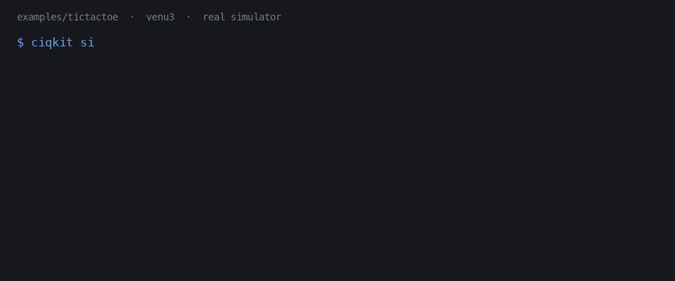

# ciqkit

Verified screenshots, navigation and unit tests from the Connect IQ Simulator, for
scripts, CI and coding agents building [Garmin Connect IQ](https://developer.garmin.com/connect-iq/) watch apps.
Unofficial; not affiliated with Garmin ([TRADEMARKS.md](TRADEMARKS.md)).



* **Screenshots you can trust.** Every capture proves your app replaced the watch face first; `--anchor` also checks the text on screen.
* **One simulator, many callers.** A broker queues scripts, test runs and agents with priorities and preemption instead of letting them collide.
* **An agent can test its own watch app.** The same jobs as MCP tools (`ciqsim_*`), plus checks for content clipped by a round bezel.

[Try the example](docs/tutorial/02-run-the-example.md) · [Install](#install) · [How it compares](#how-it-compares) · [Security](SECURITY.md) · [Apache-2.0](LICENSE) · Simulator: **macOS and Windows** · Linux: static checks and broker core

**Why not just `monkeydo`?** `monkeydo` pushes an app and returns at once, so a script that screenshots next often captures the watch face that was still showing, and two scripts on one simulator corrupt each other's run. ciqkit adds the waiting, the proof that the app loaded, and the queue; it calls the SDK's own tools underneath ([comparison](#how-it-compares)).

<sub>The GIF is drawn by [`docs/demo/make_demo.py`](docs/demo/make_demo.py) from a real run against [`examples/tictactoe`](examples/tictactoe/README.md).</sub>

| | |
| --- | --- |
| **New to Garmin?** | Start with the [tutorial](docs/tutorial/README.md): install, run an example app, change it, and verify the change on a real simulated screen. |
| **Have a project?** | Read [Adopting ciqkit](docs/adopt.md): `doctor`, `init`, baselines per screen, CI checks. |

---

## Why

The Connect IQ Simulator is a single GUI process per machine that runs one app
at a time. That makes it awkward to automate:

* Two things that want it at once corrupt each other's run. A screenshot script
  and a test suite cannot both drive it.
* `monkeydo` pushes an app and returns immediately, so a naive script screenshots
  the *watchface* it was showing before, and you do not find out until you look
  at the PNG.
* A long test run holds the simulator, and there is no way to get one urgent
  screenshot in front of it without killing the run.

ciqkit puts one owner in front of the simulator and schedules **preemptible,
priority-ordered jobs** against it. Every load is **verified** before anything
is captured: the frame must not be blank and must not be Connect IQ's own
loading screen, and it must be the app — proved by watching the loading screen
come and go since the push (on Windows, the simulator's device view being
re-created by the push), or by the round face differing from the pre-push
frame. Pass `--anchor` and the text you expect must be on screen too.

## How it compares

ciqkit is not the only Connect IQ automation around, and for some jobs another
tool is the better pick:

| | What it does | Where it wins | Where ciqkit differs |
| --- | --- | --- | --- |
| `monkeydo` + `screencapture` (SDK) | Push a build to the simulator; grab the screen yourself | Nothing to install; Garmin's own tools | ciqkit waits for and proves the load, queues callers, and runs nav and tests as jobs |
| Garmin's Monkey C VS Code extension | Build, run and debug from the editor | Debugger, official, interactive | ciqkit is for unattended runs: scripts, CI, agents |
| [matco/connectiq-tester](https://github.com/matco/connectiq-tester) (+ GitHub Action) | Runs Connect IQ unit tests headless in Docker | **Linux CI with no desktop.** ciqkit does not drive the simulator on Linux | No screenshots or navigation there; ciqkit needs macOS or Windows but captures and drives screens |
| [garmin-simulator-crossplatform-mcp](https://github.com/wroblisko/garmin-simulator-crossplatform-mcp) | MCP server: build, push, send keys, screenshot | Small and simple | ciqkit adds load verification, a broker shared by scripts and agents, OCR anchors and image checks |
| [garmin-documentation-mcp-server](https://github.com/ztuskes/garmin-documentation-mcp-server) | SDK docs over MCP from a local copy | Same idea as `tools/sdk-mcp` | `tools/sdk-mcp` indexes the SDK already installed, plus a curated list of Monkey C pitfalls |

## What is in the box

| Piece | What it does |
| --- | --- |
| `ciqkit sim` | Screenshots (`shot`, and `shots --all` for the screens named in `ciqkit.toml`), time-sampled GIFs, scripted navigation and unit-test runs against the simulator, through a scheduling broker with priorities and preemption. Builds your app itself unless you configure a build. |
| `ciqkit-mcp` | The same, exposed as [MCP](https://modelcontextprotocol.io) tools (`ciqsim_*`) so a coding agent can drive the simulator. |
| `ciqkit new` | Starts a project from a template (`blank` app / watch face / data field, or the `tictactoe` example): fresh app id, manifest, unit-test skeleton, `ciqkit.toml`, `.mcp.json`, `CLAUDE.md`, and a developer key if you have none. See [docs/init.md](docs/init.md). |
| `ciqkit init` | Sets an existing project up for ciqkit: `ciqkit.toml`, MCP servers, a marked `CLAUDE.md` block, `.gitignore` entries, optional CI workflow. Dry run until you pass `--write`. See [docs/adopt.md](docs/adopt.md). |
| `ciqkit keygen` | Creates the developer key the built-in build signs with. |
| `ciqkit doctor` | Checks the environment; `--project DIR` also checks a project (manifest, devices, key, build route, tests). |
| `ciqkit.toml` | Optional per-project settings: build commands, default device, named screens. See [docs/config.md](docs/config.md). |
| [`examples/`](examples/tictactoe/README.md) | A complete watch app, `tictactoe`, set up for ciqkit: unit tests, four named screens, three devices. MIT-0. |
| `ciqkit layout` | Flags watch screens whose content clips the round bezel, lands in the dead corners, or overlaps. |
| `ciqkit shot-score` | Scores a screenshot 0–100 — catches blurred grabs, wrong sizes, and the flat blue "app had not loaded yet" capture. |
| `ciqkit icon` | Composites a BETA ribbon onto a launcher icon; fails a build if the icon is byte-identical to another project's. |
| `ciqkit storage` | Journal, reset and replay the simulator's per-app storage: every run starts from a declared state (fresh by default), and a crash pins the storage it booted on next to its screenshots. Storage follows the app UUID, not the PRG name. |
| `ciqkit lease` | Run any command while holding a machine-wide named lock, so your own scripts serialise on the simulator too. |
| `tools/sdk-mcp` | An MCP server that answers Connect IQ API questions from the SDK docs **installed on your own machine**. |

## Requirements

* **macOS or Windows 10/11** — the platforms ciqkit can drive the simulator
  on. See [Platform support](#platform-support).
* **Python 3.10+**
* **The Connect IQ SDK**, installed yourself via Garmin's
  [SDK Manager](https://developer.garmin.com/connect-iq/sdk/). ciqkit ships no
  Garmin files and cannot install it for you.
* **macOS:** Accessibility permission for the terminal you run from, and for
  `/usr/bin/osascript`. Without it, window control silently fails and looks
  exactly like "the simulator did not start". `ciqkit doctor` tells you.
  The terminal also needs **Screen Recording**, because captures are screen grabs.
* **Windows:** Java on `PATH` (the SDK's own tools need it), and
  [Git for Windows](https://git-scm.com/download/win) if your build command is
  a shell script — the default, `./scripts/build.sh`, is. ciqkit runs it with
  Git's bash, never the WSL `bash.exe`. Gestures need an unlocked desktop;
  screenshots, recordings and test runs do not. See
  [docs/install.md](docs/install.md#3-windows).

## Install

Try it on the example app, four commands (macOS, SDK installed, see
[Requirements](#requirements); on Windows see the
[note on what is not yet verified there](#platform-support)):

```bash
pip install "ciqkit[sim,ocr]"
ciqkit new tictactoe --template tictactoe && cd tictactoe
ciqkit doctor --project .
ciqkit sim shots --all --native --out-dir shots   # first run starts the simulator
```

Pick extras to taste:

```bash
pip install "ciqkit[sim]"          # drive the simulator: capture + input
pip install "ciqkit[sim,ocr]"      # + verify on-screen text (macOS + Windows)
pip install "ciqkit[checks]"       # only the static checks, no GUI needed
```

The static checks (`layout`, `shot-score`, `icon`) work on PNGs captured
anywhere, so `[checks]` is all you need in CI.

Then check your environment before anything else:

```bash
ciqkit doctor
```

It prints the SDK it found, whether the Accessibility grant (macOS) or Java,
an unlocked desktop and the simulator's touch setting (Windows) are in place,
and which optional dependencies are installed. Fix anything it flags first — every
later failure is more confusing than the one `doctor` reports.

## Quickstart

First time? The [tutorial](docs/tutorial/README.md) walks through all of this with an example app.

From inside a Connect IQ project (a directory with a `manifest.xml`):

```bash
# Capture one screen. Builds the project first unless you pass --prg.
ciqkit sim shot home --out-dir ./screenshots

# Assert the screen really says what you expect (exit 3 if it does not).
# Needs an OCR backend: pip install "ciqkit[sim,ocr]"
ciqkit sim shot home --anchor "TOTAL" --out-dir ./screenshots

# Use a build you already made, and skip building entirely.
ciqkit sim shot home --prg bin/MyApp.prg --out-dir ./screenshots

# Record 8 seconds to an animated GIF plus a numbered contact sheet.
ciqkit sim record splash --duration 8 --out-dir ./screenshots

# Check what you captured.
ciqkit layout ./screenshots --fail-under 80
ciqkit shot-score ./screenshots --fail-under 70
```

Jobs queue behind each other. If a long run is in the way and you want one shot
now:

```bash
ciqkit sim status          # see the queue
ciqkit sim shot now --urgent
```

The urgent job runs at the next chunk boundary; the displaced job pauses and
resumes afterwards, replaying its load and navigation if yours replaced its app.

If a command prints `wait timeout`, the job has not been cancelled — it is
still running and will still write its output. Pick it back up with
`ciqkit sim wait <job_id>`.

### Building

With no `--prg`, ciqkit runs `./scripts/build.sh -d <device>` inside the project
— i.e. **it executes a script from that directory**. If your project builds
differently, set the command:

```bash
export CIQKIT_BUILD_CMD='monkeyc -o bin/MyApp.prg -d {device} -f monkey.jungle -y dev_key.der'
```

Or put it in `ciqkit.toml` (`[build] cmd`, `[sim] device`, named `[[screens]]` for
`ciqkit sim shots --all`; see [docs/config.md](docs/config.md) for the schema and
precedence), or avoid it entirely by always passing `--prg`. See
[SECURITY.md](SECURITY.md#2-pointing-ciqkit-at-a-project-runs-that-projects-code).

### Use from a coding agent

```jsonc
// .mcp.json  (Claude Code, or any MCP client)
{ "mcpServers": { "ciqsim": { "command": "ciqkit-mcp" } } }
```

Read [SECURITY.md](SECURITY.md#3-the-mcp-server-inherits-both-of-the-above)
first: an MCP client with these tools can build any project it names.

### SDK API lookup

`tools/sdk-mcp` is a separate Node MCP server that answers "what is the exact
2026 signature of `dc.drawText`?" from the SDK docs on your machine, plus a
curated set of Monkey C pitfalls. It ships **no Garmin documentation** — you
generate the index locally in one command. See
[docs/sdk-mcp.md](docs/sdk-mcp.md).

## Platform support

| | Simulator control | Static checks | Leases | `doctor` |
| --- | --- | --- | --- | --- |
| macOS | Supported, used daily | Supported, in CI | Supported, in CI | Supported |
| Windows 10/11 | Supported, verified live on Windows 11 (SDK 8.4.1) | Supported, in CI | Supported, in CI | Supported |
| Linux | Not built yet (see below) | Supported, in CI | Supported, in CI | Reports the missing simulator |

What "verified" means here:

* **macOS** is the platform ciqkit was built on and is used on every day.
* **Windows** was run end to end on one Windows 11 machine (200 % scaling,
  SDK 8.4.1): `doctor`, shots, recordings, test runs, OCR anchors, leases,
  storage, the MCP server, `tools/sdk-mcp`, and keys, taps, swipes and holds
  through the background broker. The full test suite runs in CI on
  `windows-latest` (Python 3.10 and 3.13). Added after that pass and so far
  only covered by those tests, not run against a real simulator on Windows:
  `ciqkit new` / `init`, the built-in `monkeyc` build (no `scripts/build.sh`)
  and `ciqkit keygen`.
* **Linux** runs the full test suite (broker core, leases, static checks) in
  CI and was checked by hand in Debian containers (arm64, Python 3.10 and
  3.13). Garmin ships a beta Linux SDK and simulator; what is missing is
  ciqkit's side: driving it needs a Linux backend for finding, capturing and
  sending input to the simulator window (X11, or Xvfb for headless CI), and
  nobody has needed one yet. It is a well-bounded piece of work — the broker,
  transport and checks already run there — so if you want simulator runs in
  Linux CI, [open a feature request](https://github.com/JohannesHoh/ciqkit/issues).

The static checks (`layout`, `shot-score`, `icon`) are pure image processing and
run anywhere, including in CI on Linux, on screenshots captured elsewhere.

**Linux CI today.** Most CI runs on Linux, where ciqkit cannot drive the
simulator yet. Split the work: run your unit tests headless in Linux CI with
[matco/connectiq-tester](https://github.com/matco/connectiq-tester) (Docker
image + [GitHub Action](https://github.com/matco/action-connectiq-tester)), and
run the static checks there on screenshots committed as baselines; capture and
navigate the screens with ciqkit on a macOS or Windows machine.

What differs on Windows, so nothing here surprises you:

* **The broker's control channel** is loopback TCP plus a per-broker secret
  token instead of a unix socket (CPython has none there); the runtime
  directory is `%LOCALAPPDATA%\ciqkit\runtime`, restricted to your account.
  See [SECURITY.md](SECURITY.md).
* **Capture reads the window's own drawing** (`PrintWindow`), so a screenshot is
  right even when the simulator is partly covered, and keeps working while the
  PC is locked. It comes out at the watch's native pixel size.
* **Gestures are real mouse and keyboard input**, like on macOS — the simulator
  ignores posted window messages. ciqkit brings the simulator to the front,
  moves it on-screen if it hangs below the taskbar, and fails a gesture at once,
  saying why, when the session is locked. Tap/swipe `x`/`y` fractions are of
  the watch **screen** (the simulator always draws the device body around it).
* **The simulator's own Touch Screen setting** decides whether taps and swipes
  do anything; `ciqkit doctor` warns when it is off. Button keys work either way.
* **Build commands** that are shell scripts run under Git for Windows' bash;
  without it, a `scripts\build.cmd`/`.bat`/`.ps1` next to `build.sh` is used.
* **monkeydo's probe-skipping shim** (see [docs/sim.md](docs/sim.md)) is a
  batch file plus a small relay on Windows, so another program on port 1234 is
  skipped there too and no `shell.exe` is left running after a push.

## Limits — read before you rely on this

* **Screenshots are timing-dependent.** On macOS capture is a screen-region
  grab, so the simulator window must stay unobscured for the duration of a job
  (Windows reads the window's own drawing, so covering it is fine). On a busy
  desktop a frame can catch the wrong moment.
* **`layout` and `shot-score` are advisory scores, not gates.** Telling clipped
  text apart from an intentional rim arc is not reliably possible from pixels.
  They exit non-zero only when you pass `--fail-under`. The strongest real
  signal is a score that *drops* against a screen's own baseline.
* **OCR is optional and best-effort.** Without an OCR backend, every anchor
  check degrades to "skip", never to "fail". Small watch fonts miss sometimes.
* **`nav` is deliberately simple.** It replays gestures you supply and verifies
  the destination; it is not a UI-tree driver and does not discover widgets.
* **The load check needs the screen to change.** An app whose first screen is
  pixel-identical to the watchface behind it cannot be distinguished by pixels.
  Related: on macOS a cold push of an unchanged build costs one simulator
  restart (~40 s) — see [docs/sim.md](docs/sim.md#known-limits). Keeping the
  broker running between captures avoids it. Windows sees the push land
  directly and has no such cost.
* **`record` is a sampler, not a screen recorder.** Each frame is its own
  window grab, measured **~0.22 s per frame (≈4.6 fps)** on one macOS machine —
  a 12 s clip yields ~50 frames (Windows: ~5 fps, the default 200 ms floor). `--interval` is a floor, not a rate, and 4.6 fps
  is sampling, not video: fast animation still aliases. It used to be ~2.1 s per
  frame (≈0.5 fps); that was ciqkit's own per-grab window raise and a per-frame
  flood fill, not the simulator.
* **The simulator's port range is Garmin's, not ours.** monkeydo only looks on
  127.0.0.1:1234–1238 and neither end can be configured. Another program on 1234
  is tolerated (ciqkit skips it); five taken ports are not. See
  [docs/sim.md](docs/sim.md#the-simulator-port).
* **This is a personal tool made public**, at version 0.1.0. It is used daily on
  one macOS machine against real projects and has been verified on one Windows 11
  machine. It has not been exercised across many setups. Expect rough edges and please report them.

## Scope

[docs/scope.md](docs/scope.md) draws the line between what belongs in this
project and what does not, and why.

## Documentation

* [docs/tutorial/](docs/tutorial/README.md) — newcomer walkthrough, from install to your own app
* [docs/adopt.md](docs/adopt.md) — add ciqkit to an existing project
* [docs/install.md](docs/install.md) — setup in detail, and what to do when
  `doctor` complains
* [docs/init.md](docs/init.md) — `ciqkit new` and `ciqkit init`
* [docs/config.md](docs/config.md) — `ciqkit.toml`
* [docs/sim.md](docs/sim.md) — the simulator broker: jobs, priorities, seeding
* [docs/checks.md](docs/checks.md) — `layout`, `shot-score`, `icon`
* [docs/sdk-mcp.md](docs/sdk-mcp.md) — the SDK lookup MCP server
* [docs/scope.md](docs/scope.md) — what belongs in this project and what does
  not
* [docs/design/broker.md](docs/design/broker.md) — why the broker is shaped the
  way it is
* [SECURITY.md](SECURITY.md) — threat model. Worth reading before first use.

## Contributing

See [CONTRIBUTING.md](CONTRIBUTING.md). Bug reports with a reproducible case are
the most useful thing you can send.

## Licence

[Apache License 2.0](LICENSE). See [NOTICE](NOTICE) and
[TRADEMARKS.md](TRADEMARKS.md). The example apps under [`examples/`](examples/)
are [MIT-0](examples/LICENSE), so you can copy them into your own app without
carrying a licence notice along.
